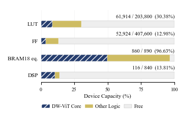

# DW-ViT: In-Camera FPGA Ion Readout

FPGA-adapted image-only readout for fixed **88 x 456** grayscale images on a camera-mounted **Kintex-7 XC7K325T (xc7k325tffg900-2)**. This update adds DW-ViT alongside the preserved legacy DWNetV2 work.

## Current model and implementation

- **376,321 parameters; 415,244,544 analytic MACs/frame (0.415 GMAC).**
- Patch-8, 627 tokens, two 64-dimensional/two-head Transformer blocks.
- Dilated (d=2) 3x3 depthwise convolution plus a 1x1 pointwise decoder projection; the decoder dilation is selected using validation data only.
- Query-row-wise global attention, in-place token updates, three-row parity-pass buffering, Q/K/V-to-decoder and token-to-BFS workspace reuse, 16-channel depthwise accumulation, shared 16-lane matrix computation, and banked W8 ROM.
- The complete routed channel-parallel camera build uses **860/890 BRAM18 equivalents, 116 DSPs, 61,914 LUTs, and 52,924 FFs**. Counts include camera, preloaded USB interface, and debug logic, not only the model core. Seven critical methodology warnings remain: this is experimental hardware, not production signoff.

## Recognition results and limits

Previously exposed 2,000-image diagnostic; scratch FP32, seed 1, fixed 20 epochs. This is **not** a new blind test, convergence proof, or multi-seed result.

| Model | Parameters | Analytic GMAC | All Site Accuracy (%) | All-300 Correct (%) | Mixed Site Accuracy (%) | Mixed All-300 Correct (%) |
|---|---:|---:|---:|---:|---:|---:|
| ESPNet-p2q8 | 365,130 | 0.367 | 99.1038 | 38.70 | 98.6367 | 2.70 |
| UNeXt-S | 253,561 | 0.070 | 98.6672 | 29.50 | 98.0130 | 0.50 |
| EGE-UNet | 53,374 | 0.051 | 98.1042 | 21.00 | 97.3867 | 0.00 |
| DW-ViT | 376,321 | 0.415 | **99.2803** | **39.15** | **98.9520** | **5.40** |

DW-ViT is **not smaller than every baseline**. Its run has **219 unmatched detections** and **34.95% record-exact accuracy**. All-300 correctness ignores unmatched detections; record-exact additionally requires none. Parameter/MAC accounting and source provenance are in [the aggregate results](results/dw_vit/).

Software W8/A18 boundary validation (5,000 validation frames) is not HLS/RTL hardware accuracy: FP32 all-site/all-300 = 99.4727%/50.00%; boundary simulation = 99.4733%/50.32%. Internal numerical executions differ; one checked frame has seven differing mask pixels between the boundary simulation and complete HLS C.

## Completed FPGA dataset replay

The selected channel-parallel DW-ViT bitstream completed **2,000/2,000 frames**. An independent offline audit verified exactly 2,000 unique IDs, all raw output-file SHA-256 hashes, decoded centroid/area records, input counts/signatures, and transport checks. Offline site predictions and all aggregate metrics were recomputed from the frozen annotations and match the run summary.

The benchmark was previously exposed during development. Hardware rows below are **FPGA output records scored offline**, not software boundary simulation and not directly emitted 300-bit state registers.

| Execution | All Site Accuracy (%) | All-300 Correct (%) | Mixed Site Accuracy (%) | Mixed All-300 Correct (%) | Extra Detections | All Record-Exact (%) |
|---|---:|---:|---:|---:|---:|---:|
| FP32 software | 99.2803 | 39.15 | 98.9520 | 5.40 | 219 | 34.95 |
| FPGA W8/A18 realization | **99.2882** | **38.90** | **98.9697** | **4.90** | **224** | **34.65** |

The complete replay establishes full-dataset board execution, **not numerical equivalence to FP32**. State-level point estimates change in different directions; extra detections increase and record-exact accuracy decreases. Do not replace the FP32 baseline-comparison table with hardware numbers as if they used the same numerical execution.

Evidence:
- [Final aggregate board results](results/dw_vit/board_full_snapshot.json)
- [Independent 2,000-frame audit](results/dw_vit/final_board_audit.json)
- [Per-frame raw-output hashes, without centroids or truth](results/dw_vit/board_output_hashes.json)
- [Model, bitstream, and release summary](results/dw_vit/release_summary.json)

The earlier five-frame serial/fast hardware consistency check is retained as separate evidence. It is not extended to all 2,000 frames or equated with full HLS-C/RTL bit equivalence. The camera returns bright-ion centroid/area records; site-state assignment uses annotations for offline scoring only. Live-ion input, calibrated sensor-to-network input, direct on-board 300-bit output, and closed-loop feedback remain unverified.

## Code map

| Path | Contents |
|---|---|
| [nets/DWViT.py](nets/DWViT.py) | Self-contained, checkpoint-compatible DW-ViT PyTorch model |
| [dw_vit/](dw_vit/) | Training/validation/export helpers, HLS kernels, and integration source |
| [results/dw_vit/](results/dw_vit/) | Frozen aggregate FP32, quantization, training, route, and board-snapshot evidence |
| [figures/dw_vit/](figures/dw_vit/) | Resource chart and editable hardware-memory diagram |
| [docs/legacy/DWNetV2_README.md](docs/legacy/DWNetV2_README.md) | Archived legacy documentation; not current DW-ViT evidence |

See [DW-ViT reproduction and prerequisites](dw_vit/README.md) and [the release manifest](results/dw_vit/release_manifest.json).

## Release boundaries

New files do not include dataset images/labels, frozen data caches, trained checkpoints, learned parameter headers/ROM contents, bitstreams, Vivado DCPs/generated IP products, USB vendor DLLs, or credentials. Existing legacy files/checkpoints remain untouched. Raw data and trained DW-ViT parameters must be supplied locally. This is a source-and-aggregate-results release, **not a self-contained reproduction of the complete camera bitstream**.

No training or hardware programming is triggered by importing the model or running the smoke tests.
