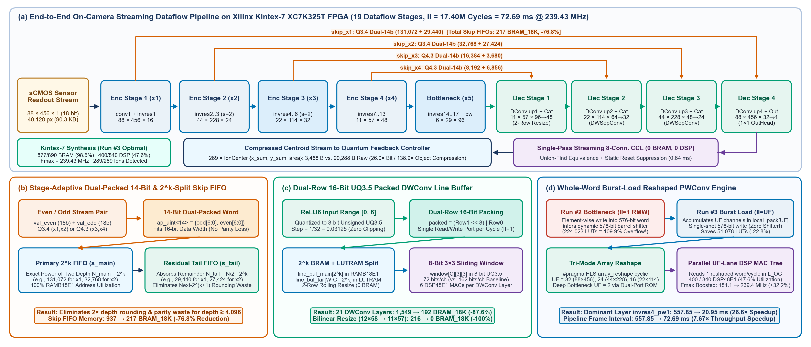
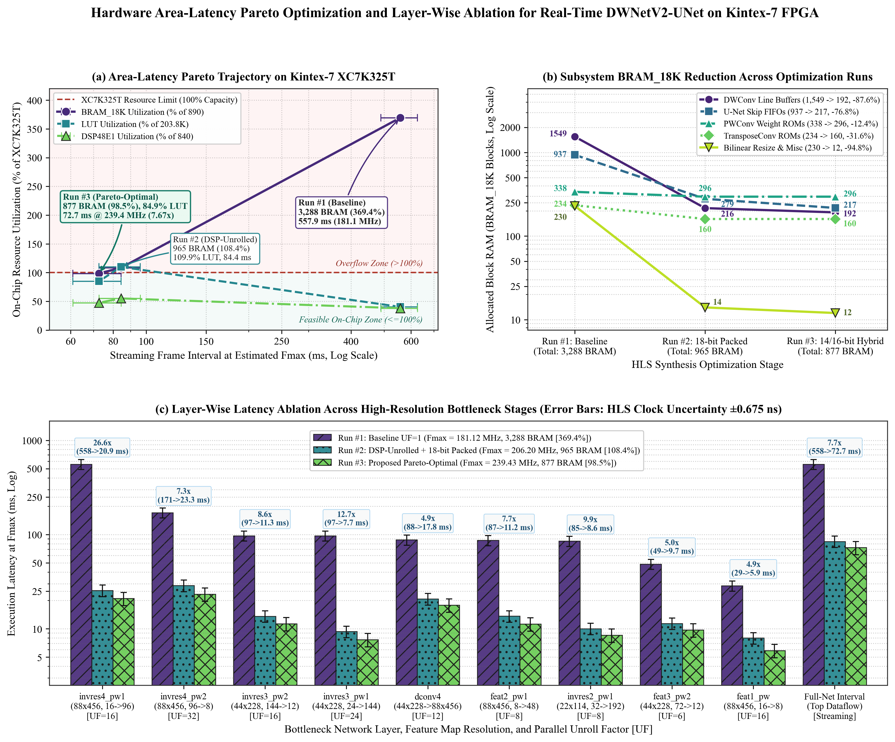

# FPGA_300Ion_Quantum_Readout

**On-Camera FPGA Acceleration of Depthwise Separable U-Net and Streaming Centroid Extraction for 300-Ion Quantum Readout Compression**

This repository contains the Vitis HLS hardware accelerator source code (`fpga_hls/`), PyTorch segmentation models (`nets/`), trained 8-bit/FP32 checkpoints (`weights/`), unified `INT8` & `ap_fixed<8,I>` evaluation scripts (`scripts/`), and synthesis/benchmark artifacts (`results/`, `figures/`) for on-camera real-time readout compression of 300-ion $^{171}\text{Yb}^+$ quantum registers on a Xilinx Kintex-7 (`xc7k325tffg900-2`) FPGA.

---

## Architecture Overview



Instead of streaming full $88 \times 456$ 18-bit sCMOS camera frames ($90,288\text{ B}$ / $722,304\text{ bits}$) to a host workstation or GPU, the on-camera FPGA executes a 19-stage streaming MobileNetV2-based depthwise separable U-Net (`DWNetV2-UNet`) followed by a zero-BRAM, zero-DSP single-pass connected-component labeling (`streaming_ccl`) centroid extractor:

1. **On-Camera Semantic Compression ($25.1\times$–$50.7\times$ Bit Reduction):** Each $88 \times 456$ sCMOS frame is compressed on the fly into compact 96-bit (`12 B`) `IonCenter = {x_hat, y_hat, Area}` packets per detected bright ion ($|1\rangle$), achieving a **$25.1\times$–$26.0\times$** payload reduction on full-bright registers ($289$–$300$ ions) and a **$50.0\times$–$50.7\times$** dynamic compression on mixed $\pi/2$ quantum states ($\sim 149$ bright ions).
2. **Stage-Adaptive Dual-Packed $2^k$-Split Skip FIFOs & Dual-Row `UQ3.5` Line Buffers:** Packing pairs of 7-bit stage-adaptive activations (`Q3.4` for shallow `x1/x2`, `Q4.3` for deep `x3/x4`) into 14-bit words ($\le 16\text{ bits}$, avoiding Xilinx 7-Series `RAMB18E1` parity-bit loss for depth $\ge 4,096$) with compile-time $2^k$ depth splitting reduces skip-FIFO BRAM by **76.8%** ($937 \to 217$ `BRAM_18K`). Dual-row 16-bit `UQ3.5` packing for `ReLU6`-bounded $3\times 3$ depthwise line buffers and a 2-row rolling LUTRAM bilinear resize unit reduce depthwise and resize BRAM by **87.6%** ($1,549 \to 192$) and **100%** ($216 \to 0$), respectively.
3. **Whole-Word Burst-Load (`II = UF`) Reshaped Pointwise Engine:** Eliminates dynamic 576-bit read-modify-write (RMW) barrel shifters during reshaped input loading, saving **51,078 LUTs (-22.8%)**, boosting $F_{\max}$ to **239.43 MHz (+32.2%)**, accelerating the dominant `invres4_pw1` layer by **26.63$\times$** ($557.85\text{ ms} \to 20.95\text{ ms}$), and improving pipeline frame throughput by **7.67$\times$**.

---

## Hardware Synthesis Progression (Xilinx Kintex-7 `xc7k325tffg900-2`)



| Metric / Resource | Kintex-7 Available | Run #1: Baseline | Run #2: DSP-Unrolled | **Run #3: Proposed Optimal** |
| :--- | :---: | :---: | :---: | :---: |
| Skip FIFO / DWConv Line Buffer | — | 18-bit Native FIFO | 16-bit Dual-8b + $2^k$ Split | **14b Stage-Adaptive FIFO + 16b Dual-`UQ3.5` LB** |
| Pointwise Load Schedule | — | Scalar (`UF=2, II=1`) | Element RMW (`UF<=32, II=1`) | **Whole-Word Burst (`UF<=32, II=UF`)** |
| Total `BRAM_18K` Blocks (%) | `890` (`100%`) | `3,288` (`369.4%`, *Overflow*) | `965` (`108.4%`, *Overflow*) | **877 (98.5%, Fits Device)** |
| Total `DSP48E1` / `FF` | `840` / `407,600` | `319` (`38.0%`) / `76.1k` | `463` (`55.1%`) / `124.1k` | **400 (47.6%) / 102,604 (25.2%)** |
| Total `LUT` (%) | `203,800` (`100%`) | `82,032` (`40.3%`) | `224,023` (`109.9%`, *Overflow*) | **172,945 (84.9%, Fits Device)** |
| Estimated $T_{\text{clk}}$ ($F_{\max}$) | `5.000 ns` (`200 MHz`) | `5.521 ns` (`181.12 MHz`) | `4.850 ns` (`206.20 MHz`) | **4.176 ns (239.43 MHz, +32.2%)** |
| Dominant `invres4_pw1` Time | — | `557.85 ms` (`101.04M` cyc) | `25.49 ms` (`5.26M` cyc) | **20.95 ms (5.02M cyc, 26.63$\times$)** |
| Dataflow Frame Interval | — | `557.85 ms` (`1.79 FPS`) | `84.40 ms` (`11.85 FPS`) | **72.69 ms (13.76 FPS, 7.67$\times$)** |
| C-Sim Detected Ion Count | `289 / 289` GT | `289 / 289` (`100%`) | `289 / 289` (`100%`) | **289 / 289 (100%, Zero Loss)** |

---

## Unified 8-Bit (`INT8` & `HLS ap_fixed<8,I>`) Readout Benchmark

| Method / 8-Bit Quantized Model | INT8 Wt. / MACs | `Train` Full / $\pi/2$ / $F_{\text{assign}}$ ($\Delta$FP32) | `Train` Ions (Full / $\pi/2$) | `Benchmark` Full / $\pi/2$ / $F_{\text{assign}}$ ($\Delta$FP32) | `Benchmark` Ions / MAE / $\text{CR}_{\text{bit}}$ |
| :--- | :---: | :---: | :---: | :---: | :---: |
| `OpenCV Otsu + 8-Conn CCL` | `0 KB` / — | `97.85%` / `96.82%` / `97.34%` | `145.3` / `149.0` | `97.95%` / `95.28%` / `96.62%` | `144.6` / `147.3` \| `0.893 px` \| — |
| `Standard U-Net [INT8]` | `31.04 MB` / `23.81G` | `99.87%` / **93.99%** / **96.93%** (`-0.00%`) | `300.1` / `152.9` | **99.94%** / **94.68%** / **97.31%** (`-0.00%`) | **300.0** / `146.7` \| `0.480 px` \| `25.1x, 51.3x` |
| `ViTSeg [INT8]` | `5.29 MB` / `4.15G` | `99.87%` / `93.55%` / `96.71%` (`+0.01%`) | **300.0** / `150.9` | **99.94%** / `93.89%` / `96.91%` (`-0.02%`) | **300.0** / `149.1` \| `0.480 px` \| `25.1x, 50.5x` |
| `PSFANet [INT8]` | `4.68 MB` / `3.82G` | `99.86%` / `93.64%` / `96.75%` (`-0.09%`) | **300.0** / `153.5` | `99.91%` / `93.65%` / `96.78%` (`-0.24%`) | **300.0** / `145.7` \| `0.482 px` \| `25.1x, 51.6x` |
| `DWNetV2_pretrained [INT8]` | `4.68 MB` / `3.82G` | `99.87%` / `86.52%` / `93.19%` (`-3.68%`) | **300.0** / `152.3` | `99.89%` / `91.71%` / `95.80%` (`-1.23%`) | `299.9` / `142.3` \| `0.504 px` \| `25.1x, 52.9x` |
| `DWNetV2_pretrained [HLS ap_fixed<8,I>]` | `4.68 MB` / `3.82G` | `95.54%` / `91.79%` / `93.66%` (`-3.21%`) | `286.4` / `144.8` | `95.39%` / `91.22%` / `93.31%` (`-3.72%`) | `285.5` / `134.7` \| `0.567 px` \| `26.4x, 55.8x` |
| `DWNetV2_scratch [INT8]` | `4.68 MB` / `3.82G` | `99.85%` / `93.53%` / `96.69%` (`+0.01%`) | **300.0** / `150.9` | **99.94%** / `93.83%` / `96.88%` (`-0.00%`) | **300.0** / `148.3` \| **0.479 px** \| `25.1x, 50.7x` |
| **Ours: `DWNetV2_scratch [HLS ap_fixed<8,I> + CCL]`** | **0.76–4.68 MB** | **99.85%** / **93.48%** / **96.66%** (**`-0.02%`**) | **300.0** / **150.5** | **99.94%** / **93.76%** / **96.85%** (**`-0.03%`**) | **300.0** / **148.5** \| **0.479 px** \| **25.1x, 50.7x** |

---

## Repository Structure

```text
FPGA_300Ion_Quantum_Readout/
├── fpga_hls/                  # Vitis HLS 2022.2 C++ accelerator & streaming CCL sources
│   ├── dwnet_config.h         # Image dimensions (88x456) and hardware configuration
│   ├── dwnet_types.h          # 18-bit activation & layer-adaptive 8-bit weight types
│   ├── dwnet_layers.h/.cpp    # Dual-packed Skip FIFO, UQ3.5 DWConv, II=UF Burst PWConv
│   ├── dwnet_unet.h/.cpp      # Top-level 19-stage DATAFLOW streaming architecture
│   ├── streaming_ccl.h/.cpp   # Single-pass 0-BRAM/0-DSP union-find centroid extractor
│   ├── dwnet_weights_all.cpp  # BN-fused 8-bit fixed-point ROM weights
│   ├── tb_dwnet_unet.cpp      # Bit-accurate C-simulation testbench
│   ├── run_hls.tcl            # Automated Vitis HLS C-sim & synthesis Tcl script
│   └── reports/               # Archived Vitis HLS csynth reports (Run #2 & Run #3)
├── nets/                      # PyTorch model definitions (DWNetV2-UNet, ViTSeg, U-Net, PSFANet)
├── weights/                   # Trained PyTorch checkpoints (DWNetV2_scratch, pretrained, ViTSeg)
├── scripts/                   # Unified INT8 evaluation & Pareto plotting scripts
├── results/                   # Structured JSON and CSV experimental benchmark tables
└── figures/                   # High-resolution architecture & Pareto ablation figures
```

---

## Quick Start

### 1. Run Vitis HLS C-Simulation and Synthesis
```bash
cd fpga_hls
vitis_hls -f run_hls.tcl
```

### 2. Run Unified INT8 & Hardware Fixed-Point Evaluation
```bash
pip install -r requirements.txt
python scripts/test_int8_all.py
```

### 3. Regenerate Area-Latency Pareto & Layer Ablation Figures
```bash
python scripts/plot_iscas_pareto.py
```

---

## License

Released under the [MIT License](LICENSE).
